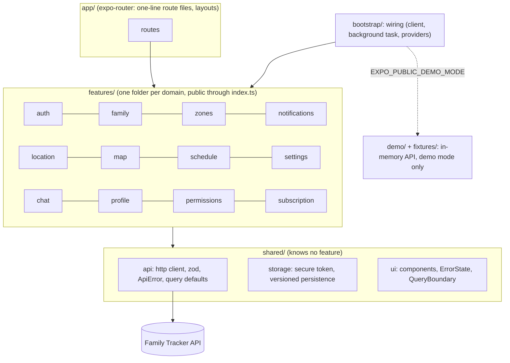

# Family Tracker (mobile)

A React Native app for families to share locations, get alerts when someone arrives at or leaves a place, and reach each other in an emergency. It is the mobile client of the Family Tracker API (NestJS) and talks to it over a stable REST contract.

Built with Expo (SDK 53), expo-router, TypeScript in strict mode, TanStack Query and zod.

## See it

No backend needed: `npm run demo` starts the app on an in-memory API with fictional data, so every screen can be opened.

## Features

- Live family map with each member's position, battery level and sharing status.
- Background location sharing (foreground service on Android, background updates on iOS).
- Safe zones: circular geofences with per-member tracking, enter and exit alerts, and time-spent analytics by day and visit.
- Emergency and "heading home" alerts with the sender's position.
- Location history for a day, week or month.
- Privacy controls: who sees your location, which notifications you get, and (premium) sharing schedules by weekday and time window.
- Family management: invite by email, roles, deep-link invitations.
- One-to-one chat between members.
- Premium subscription with a card payment sheet.

## Architecture



Inside a feature:

```
features/zones/
  api/        zonesApi.ts            one-line calls into shared/api, with zod schemas
  model/      zone.ts, geo.ts, ...   types and pure logic (no React): most tests live here
  hooks/      useZones.ts            TanStack Query hooks, key factories
  components/ ZoneForm.tsx ...       small presentational pieces
  screens/    ZonesScreen.tsx ...    composition, three states: loading, error, data
  index.ts                           the only way other features may import this one
```

Rules, enforced by `npm run lint` and `__tests__/architecture.test.ts`:

- `app/` contains only re-exports of feature screens and layouts.
- A feature imports another feature only through its `index.ts`; features form no cycles.
- `shared/` imports no feature.
- No `console.*`, no `any` without a comment.

## Run it

Requirements: Node 20+, and for device builds Xcode or the Android SDK.

```bash
npm install --legacy-peer-deps
cp .env.example .env        # set EXPO_PUBLIC_API_BASE_URL at least
npm start                   # Expo dev server; open in Expo Go or a dev build
```

No backend? Demo mode runs against an in-memory API filled with fictional data:

```bash
npm run demo
```

Native builds (the `android/` and `ios/` folders are generated, not tracked):

```bash
npx expo prebuild
npm run android   # or: npm run ios
```

Maps need your own key (`EXPO_PUBLIC_GOOGLE_MAPS_API_KEY`), and push notifications need a Firebase file passed as `GOOGLE_SERVICES_FILE` at build time. See [google-services.json.example](google-services.json.example).

After switching `EXPO_PUBLIC_DEMO_MODE` on or off, restart Metro with `--clear`; the transform cache does not notice the change.

## Configuration

Everything here ships in the app bundle, so only public values belong in these variables.

| Variable | Required | Purpose | When missing |
| --- | --- | --- | --- |
| `EXPO_PUBLIC_API_BASE_URL` | yes (unless demo mode) | Base URL of the API | the config fails with a clear message |
| `EXPO_PUBLIC_IDEMPOTENCY_KEYS` | no | `0` stops sending `Idempotency-Key` on family, safe-zone and alert creates | keys are sent |
| `EXPO_PUBLIC_DEMO_MODE` | no | `1` serves fictional data from memory, no server needed | off |
| `EXPO_PUBLIC_GOOGLE_MAPS_API_KEY` | for the Map screen | Maps tiles on Android and iOS | the Map screen crashes on Android (native "API key not found") |
| `EXPO_PUBLIC_STRIPE_PUBLISHABLE_KEY` | no | Premium checkout | payment sheet cannot open |
| `EXPO_PUBLIC_STREAM_API_KEY` | no | Chat | chat shows "not configured" |
| `EXPO_PUBLIC_ANDROID_CLIENT_ID`, `EXPO_PUBLIC_IOS_CLIENT_ID` | no | Google sign-in | Google button does nothing |
| `EXPO_OWNER`, `EAS_PROJECT_ID` | no | Your EAS account and project, for EAS builds | EAS builds are not linked |
| `GOOGLE_SERVICES_FILE` | no | Path to Firebase config, read at build time only | push is not configured in the build |

## Scripts

| Command | What it does |
| --- | --- |
| `npm run typecheck` | `tsc --noEmit`, strict |
| `npm run lint` | ESLint including the boundary rules |
| `npm test` | Jest (jest-expo, React Native Testing Library) |
| `npm run bundle` | Metro production bundle for Android |
| `npm run doctor` | `expo-doctor` |
| `npm run format` / `npm run format:check` | Prettier write / check (120 columns, single quotes) |
| `npm run dupes` | `jscpd`, fails above 1 percent duplicated code |
| `npm run check` | typecheck, lint, format check, tests and dupes |

## Tests

- **Model logic** (no React): geofence maths, schedule windows, zone form validation, analytics formatting, privacy edits, invite-link validation, route guard, chat channel ids.
- **API client** against a scripted fake server: 500s and retry, hung request, dropped connection, malformed JSON, tolerant parsing, concurrent 401s sharing one refresh.
- **Request keys**: `__tests__/request-keys.json` comes from the API's OpenAPI document; regenerate it with `node scripts/sync-request-keys.mjs <openapi.json>`, then `npm run format`.
- **Contract tests** (`__tests__/contract.test.ts`): every feature API against responses shaped like the backend DTOs, including nulls, missing optionals, unknown fields and unknown enum values.
- **Persistence**: fixtures from each old schema version must migrate into the current one.
- **Background tracking**: task registration, permission flow, headless session rebuild.
- **Smoke renders**: every route rendered through its real route module with the router mocked, in loading, error and data states, plus the real router over `app/` for the session guard.
- **Architecture checks**: route inventory and deep links unchanged, dependency rules, no secrets tracked, no raw hex colors outside `shared/ui/theme.ts`.

## Deep links

| Link | Opens |
| --- | --- |
| `app.familytracker://family-invite?invitedEmail=...&token=...` | invitation screen; params are validated before use |
| `app.familytracker://reset-password?token=...` | password reset |
| `app.familytracker://oauthredirect` | Google sign-in redirect |
| `https://familytracker.app/...` | Android app link |

## Known limitations

- `npm audit --omit=dev` reports no critical and one high finding: `image-size` inside Metro (the bundler Expo SDK 53 ships). Its fixed major breaks Metro's asset handling (`getImageSize is not a function`), so it waits for the next SDK. Only the build machine parses images with it; nothing ships in the app. CI gates on critical findings for that reason. Moderate findings are all in the same build-time chains.
- Transitive fixes are pinned through `overrides` in `package.json` (`postcss`, `lodash-es`, `decode-uri-component`). Drop them when the parent packages catch up.
- CI installs with `--legacy-peer-deps` because Expo and a few native modules declare conflicting peer ranges.

## License

[MIT](LICENSE)
